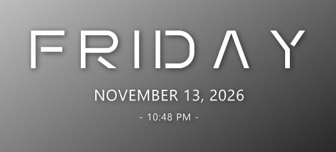
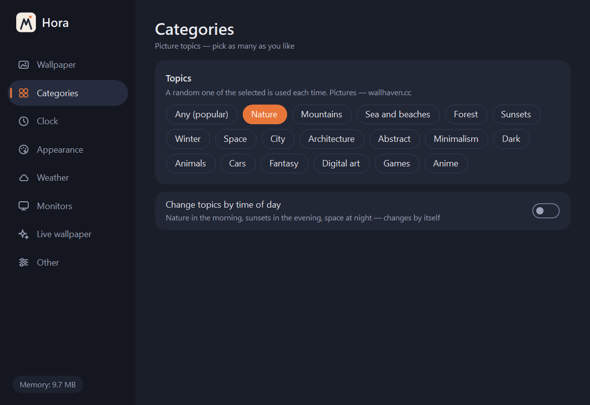

<div align="center">


# Hora

**Wallpapers, a big clock and weather right on your Windows desktop — at almost zero cost**

[Русский](README.md) | **English**

[](https://github.com/dark-knight-soul/hora/releases/latest)
[](https://github.com/dark-knight-soul/hora/actions/workflows/build.yml)


[](LICENSE)



</div>

## Features

- 🖼 **Changes your wallpaper** on a timer: [Wallhaven](https://wallhaven.cc) by category (nature, mountains, space, city…), your own folder, or both. The same picture on every monitor, a different one on each, or **spanned** — one wide picture across all screens.
- 🕰 **A big clock under your desktop icons** — 14 styles: spaced-out weekday, big time, pixel scoreboard, block pixels, "time | date", in words ("quarter to two"), calendar, analog and more. Three custom fonts with Latin and Cyrillic: split letters, LED dots (Hora Pixel) and chunky block pixels (Hora Block). Automatic color from the wallpaper's brightness, plus a halo or a "frosted glass" plate behind the text on busy backgrounds.
- ⛅ **Weather** from [Open-Meteo](https://open-meteo.com): icon, temperature, wind, humidity and a 3-day forecast.
- ✨ **Live wallpapers** (optional): snow, rain, stars, falling leaves, fireflies or "match the weather" on top of your regular wallpaper — or **video instead of a picture**, including video wallpapers from the **Wallpaper Engine** Workshop.
- ♥ **Favorites and a blacklist**: wallpapers you like come back from time to time, ones you don't are never shown again.
- 🌅 **Topic schedule**: nature in the morning, sunsets in the evening, space at night.
- ⌨️ **Hotkeys**: Win+Alt+N — next wallpaper, Win+Alt+H — add to favorites (change them in `config.ini`).
- 🔄 **One-click updates**: Hora checks GitHub once a day and installs a new version only if its digital signature matches the author's key.
- 🎞 **Wallpaper transitions**: fade, wipe, circle, blinds — the effects are done by Windows itself.

> **Language:** the settings window, tray menu and installer are in English and Russian — Hora follows your Windows language automatically (switch it in Settings → Other → Language). The clock and the weather widget have their own language setting (Settings → Clock).

<div align="center">

</div>

## Truly lightweight

| | |
|---|---|
| Memory when idle | **~5 MB** |
| CPU when idle | **0 %** — wakes up once a minute to redraw the clock |
| Size | a single ~4.5 MB file (~3 MB of it are bundled fonts) |
| Live wallpapers | rendered by the GPU in a **separate process** that only runs while they are on; when the desktop is covered by windows, the screen is locked or a laptop is on battery, everything pauses and the memory is released |

## Download

Get the latest version from [**Releases**](https://github.com/dark-knight-soul/hora/releases/latest):

| File | For whom |
|---|---|
| [**HoraSetup.exe**](https://github.com/dark-knight-soul/hora/releases/latest/download/HoraSetup.exe) | Installer. Asks whether to install **just for me** (no administrator rights needed) or **for all users**. Adds a Start menu shortcut; uninstall from Settings → Apps. |
| [**Hora-portable.zip**](https://github.com/dark-knight-soul/hora/releases/latest/download/Hora-portable.zip) | Portable version: unpack anywhere (even a USB stick) and run `Hora.exe`. Everything is stored next to it. |

> The program is not code-signed, so Windows SmartScreen may warn you on the first run: "More info" → "Run anyway". SHA-256 checksums are in `SHA256SUMS.txt` next to the release files.

Silent install without any windows (for admins and scripts): `HoraSetup.exe --silent` — just for me, `HoraSetup.exe --silent --all-users` — for all users; uninstall with `Hora.exe --uninstall --silent` (settings are kept).

## How to use

1. Start Hora — an icon with mountains and the sun appears in the tray.
2. **Click** the icon to open the settings: wallpapers, categories, clock with a live preview, appearance, weather, monitors, live wallpapers. Light and dark themes are available.
3. **Right-click** for a quick menu: next wallpaper, add to favorites, never show again, pause, clock style, live wallpapers.
4. Fine-tuning lives in `config.ini` (menu "All settings"): changes are picked up as soon as you save the file.

Where settings are stored: `%LOCALAPPDATA%\Hora` for the installed version, next to `Hora.exe` for the portable one.

<details>
<summary><b>Useful config.ini keys</b></summary>

| Key | Example | What it does |
|---|---|---|
| `interval_min` | `30` | how often to change the wallpaper, in minutes (0 — manual only) |
| `topics` | `nature,space` | categories; a random one is picked each time |
| `query` | `nature mountains` | your own Wallhaven query when no categories are selected |
| `wall_mode` | `same` / `per_monitor` / `span` | wallpaper on monitors: same / different / spanned |
| `folder` | `D:\Wallpapers` | your own folder with pictures |
| `anim` / `anim_ms` | `fade` / `900` | transition effect and its duration |
| `style` / `font` / `color` | `photo` / `Unbounded` / `auto` | clock style, font and color |
| `ui_lang` | `auto` / `en` / `ru` | language of the settings window and the tray menu (`auto` — same as Windows) |
| `lang` | `en` / `ru` | language of the clock and the weather widget |
| `clock_monitor` | `primary` / `second` / `all` | which monitor shows the clock |
| `weather_city` | `Berlin, Germany` | city for the weather (easier to pick with the search in the settings) |
| `schedule` / `schedule_hours` | `1` / `6,12,18,23` | topic schedule and when morning, day, evening and night start |
| `topics_morning` … `topics_night` | `space,dark` | categories for each time of day |
| `live` / `live_effect` | `effects` / `weather` | live wallpapers: off, effects, video; effect: snow, rain, stars, leaves, fireflies, weather |
| `video_source` / `video_folder` | `both` / `D:\Videos` | videos: your folder, Wallpaper Engine or both |
| `favorites_mix` | `20` | how often (in %) favorites show up among new wallpapers |

</details>

### Live wallpapers and Wallpaper Engine

Hora finds Steam and the wallpapers you've subscribed to in the Wallpaper Engine Workshop on its own. **Only the "video" type** (mp4/webm) is supported: scenes and web wallpapers use a closed format that only Wallpaper Engine itself can render. Put your own videos into the `videos` folder. Videos play muted, pause when the desktop isn't visible and resume where they left off.

## Privacy

Hora talks only to open services and sends nothing about you:

- `wallhaven.cc` — searching and downloading wallpapers (HTTPS only, images only from `w.wallhaven.cc`);
- `open-meteo.com` — weather and city search (the coordinates of the city you picked);
- `api.github.com` / `github.com` — a once-a-day check for a new version and its download (turn it off in Other or with `update_check = 0`).
- If Hora crashes, the reason is written to `crash.txt` next to the settings. Nothing is sent automatically: clicking the notification opens a GitHub form with the report text, and you decide whether to submit it.

No telemetry, no accounts, no ads.

## Versions and compatibility

- **Version numbers** follow [SemVer](https://semver.org/): from 1.0 on, fixes bump the third number (1.0.**1**), new features the second (1.**1**.0), and the first changes only if something stops working the way it did.
- **Settings never break.** A `config.ini` from any earlier version keeps working: new keys get defaults, old ones are still understood. A test checks this on every build.
- **Updates are signed with one key.** An installed Hora accepts only a release signed with the same key as before.
- **Windows** 10 (1809 or newer) and 11, 64-bit. All changes are in [CHANGELOG.md](CHANGELOG.md).

## Building from source

All you need is Rust (stable, `x86_64-pc-windows-gnu` toolchain — installs without administrator rights via [rustup](https://rustup.rs)).

```powershell
powershell -ExecutionPolicy Bypass -File build.ps1     # the program in dist\
powershell -ExecutionPolicy Bypass -File package.ps1   # installer and portable archive in release\
cargo test --release                                   # tests
```

Releases are signed with an ECDSA P-256 key (`tools/new-signing-key.ps1` — once, `tools/sign-release.ps1` — called by `package.ps1`). The public key is built into `src/update.rs`; an update with a wrong signature is never installed.

<details>
<summary><b>How it works</b></summary>

| File | What's inside |
|---|---|
| `src/main.rs` | tray, menu, timers, `config.ini` watching, autostart |
| `src/ui.rs` | settings window: drawn by hand (GDI+ for shapes, GDI ClearType for text), smooth scrolling and animations in sync with the display |
| `src/clock.rs` | clock and weather: alpha-blended rendering and embedding into the desktop (on Windows 11 24H2 — under the icons inside Progman) |
| `src/bg.rs` | a copy of the wallpaper sized to the screen — the clock window paints the wallpaper under itself |
| `src/wallpaper.rs` | picking, downloading and setting wallpapers, favorites and the blacklist |
| `src/live.rs` | live wallpapers: Direct3D 11, Direct2D, DirectComposition and Media Foundation in a separate process; frames are shared through composition surfaces |
| `src/setup.rs` | installer and uninstaller without third-party tools (the same exe named `HoraSetup.exe`) |
| `src/weather.rs`, `src/http.rs` | weather (Open-Meteo) and downloads via the built-in WinHTTP with the system proxy |
| `build.rs` | manifest and icon — drawn in code, no external tools |
| `tools/make_font.py` | generator of the "WallClock Split" font (Latin + Cyrillic) |
| `tools/make_pixel_fonts.py` | generator of the "Hora Pixel" and "Hora Block" pixel fonts |
| `tools/pe-harden.ps1` | post-build step that makes Windows load system DLLs only from System32 (DLL planting protection) |

</details>

## License

Code — [MIT](LICENSE). Fonts in `assets/fonts` (Michroma, Megrim, Unbounded, Jura, Russo One, Oswald, Comfortaa, Tektur, Exo 2, Montserrat Alternates, Cormorant Garamond, Press Start 2P — Google Fonts) are under the SIL Open Font License 1.1; the license texts are next to them. The custom fonts WallClock Split, Hora Pixel and Hora Block are MIT, like the code. Wallpapers belong to their authors on Wallhaven; Hora does not distribute them, it only downloads them at your choice.
