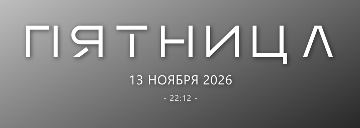
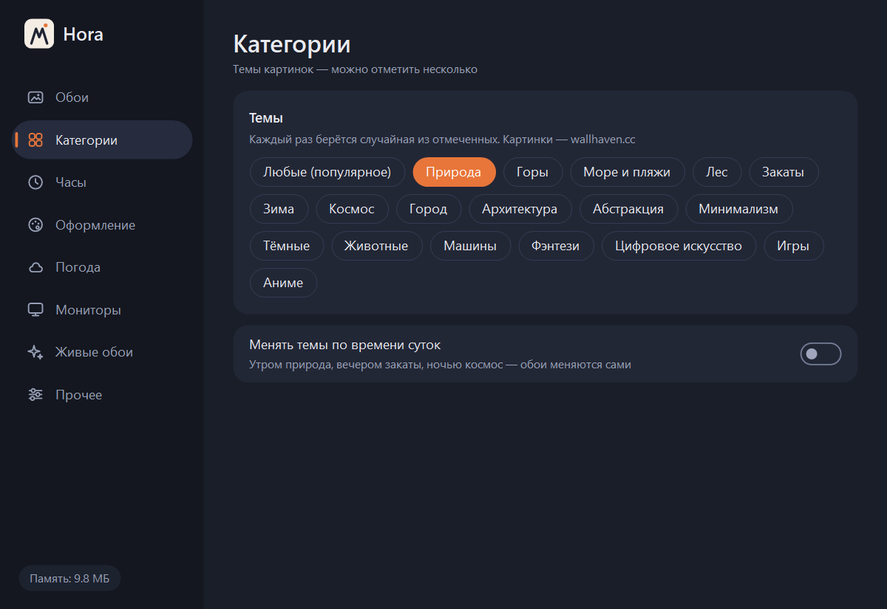

<div align="center">


# Hora

**Обои, большие часы и погода прямо на рабочем столе Windows — и почти ноль нагрузки**

**Русский** | [English](README.en.md)

[](https://github.com/dark-knight-soul/hora/releases/latest)
[](https://github.com/dark-knight-soul/hora/actions/workflows/build.yml)


[](LICENSE)



</div>

## Что умеет

- 🖼 **Меняет обои** по таймеру: [Wallhaven](https://wallhaven.cc) по категориям (природа, горы, космос, город…), своя папка или и то и другое. Одинаковые, разные на каждом мониторе или **единые** — одна широкая картинка на все экраны.
- 🕰 **Большие часы под иконками** — 14 стилей: день недели вразрядку, крупное время, пиксельное табло, блочный пиксель, «время | дата», словами («без четверти два»), календарь, стрелочные и другие. Три своих шрифта с кириллицей и латиницей: с разрывами в буквах, «табло» из точек (Hora Pixel) и блочный пиксельный (Hora Block). Авто-цвет по яркости обоев, ореол и «матовое стекло» под текстом на пёстром фоне.
- ⛅ **Погода** от [Open-Meteo](https://open-meteo.com): значок, температура, ветер, влажность и прогноз на 3 дня.
- ✨ **Живые обои** (по желанию): снег, дождь, звёзды, листопад, светлячки или «по погоде» поверх обычных обоев — либо **видео вместо картинки**, в том числе видеообои из мастерской **Wallpaper Engine**.
- ♥ **Избранное и чёрный список**: понравившиеся обои возвращаются время от времени, ненужные больше не показываются никогда.
- 🌅 **Расписание тем**: утром природа, вечером закаты, ночью космос.
- 🎞 **Анимация смены обоев**: растворение, шторка, круг, жалюзи — эффекты делает сама Windows.
- ⌨️ **Горячие клавиши**: Win+Alt+N — следующие обои, Win+Alt+H — в избранное, Win+Alt+O — окно настроек (сочетания меняются в `config.ini`).
- 🔄 **Обновления в один щелчок**: Hora раз в день проверяет GitHub и ставит новую версию, только если её цифровая подпись совпадает с ключом автора.
- 🌐 **Русский и английский**: окно, меню и установщик — на языке Windows (переключается в «Прочее»), у часов и погоды — свой выбор языка.

<div align="center">

</div>

## Лёгкая по-настоящему

| | |
|---|---|
| Память в простое | **~5 МБ** |
| Процессор в простое | **0 %** — программа просыпается раз в минуту, чтобы перерисовать часы |
| Размер | один файл ~4,5 МБ (из них ~3 МБ — встроенные шрифты) |
| Живые обои | рисует видеокарта в **отдельном процессе**, который запускается только пока они включены; когда рабочий стол закрыт окнами, экран заблокирован или ноутбук работает от батареи — всё замирает и освобождает память |

## Скачать

Последняя версия — на странице [**Releases**](https://github.com/dark-knight-soul/hora/releases/latest):

| Файл | Для кого |
|---|---|
| [**HoraSetup.exe**](https://github.com/dark-knight-soul/hora/releases/latest/download/HoraSetup.exe) | Установщик. Спросит: **только для меня** (без прав администратора) или **для всех пользователей**. Создаст ярлык в «Пуске», удалить можно в «Параметры → Приложения». |
| [**Hora-portable.zip**](https://github.com/dark-knight-soul/hora/releases/latest/download/Hora-portable.zip) | Переносная версия: распакуйте куда угодно (хоть на флешку) и запустите `Hora.exe`. Всё хранится рядом с программой. |

> Программа не подписана сертификатом, поэтому при первом запуске Windows SmartScreen может предупредить: «Подробнее» → «Выполнить в любом случае». Контрольные суммы — в `SHA256SUMS.txt` рядом с файлами выпуска.

Тихая установка без окон (для администраторов и скриптов): `HoraSetup.exe --silent` — для себя, `HoraSetup.exe --silent --all-users` — для всех; удаление — `Hora.exe --uninstall --silent` (настройки остаются).

## Как пользоваться

1. Запустите Hora — в трее появится значок с горами и солнцем.
2. **Щелчок** по значку — окно настроек: обои, категории, часы с живым предпросмотром, оформление, погода, мониторы, живые обои. Есть светлая и тёмная тема.
3. **Правый щелчок** — быстрое меню: следующие обои, в избранное, не показывать, пауза, стиль часов, живые обои.
4. Тонкие настройки — в `config.ini` (меню «Все настройки»): изменения подхватываются сразу после сохранения.

Где лежат настройки: у установленной версии — `%LOCALAPPDATA%\Hora`, у переносной — рядом с `Hora.exe`.

<details>
<summary><b>Полезные ключи config.ini</b></summary>

| Ключ | Пример | Что делает |
|---|---|---|
| `interval_min` | `30` | как часто менять обои, минуты (0 — только вручную) |
| `topics` | `nature,space` | категории, каждый раз случайная из списка |
| `query` | `nature mountains` | свой запрос для Wallhaven, если категории не выбраны |
| `wall_mode` | `same` / `per_monitor` / `span` | обои на мониторах: одинаковые / разные / единые |
| `folder` | `D:\Обои` | своя папка с картинками |
| `anim` / `anim_ms` | `fade` / `900` | эффект смены обоев и его длительность |
| `style` / `font` / `color` | `photo` / `Unbounded` / `auto` | стиль, шрифт и цвет часов |
| `ui_lang` / `lang` | `auto` / `ru` | язык окна и меню (`auto` — как в Windows) и язык часов |
| `clock_monitor` | `primary` / `second` / `all` | на каком мониторе часы |
| `weather_city` | `Berlin, Germany` | город для погоды (проще выбрать поиском в окне) |
| `schedule` / `schedule_hours` | `1` / `6,12,18,23` | расписание тем и часы начала утра, дня, вечера и ночи |
| `topics_morning` … `topics_night` | `space,dark` | категории для каждого времени суток |
| `live` / `live_effect` | `effects` / `weather` | живые обои: off, effects, video; эффект: snow, rain, stars, leaves, fireflies, weather |
| `video_source` / `video_folder` | `both` / `D:\Видео` | видео: своя папка, Wallpaper Engine или всё |
| `favorites_mix` | `20` | как часто (в %) показывать избранное среди новых обоев |

</details>

### Живые обои и Wallpaper Engine

Hora сама находит Steam и обои, загруженные из мастерской Wallpaper Engine. Поддерживается **только тип «видео»** (mp4/webm): сцены и веб-обои — закрытый формат, их умеет показывать лишь сам Wallpaper Engine. Свои видео кладите в папку `videos`. Видео играет без звука, на паузе, когда рабочего стола не видно, и продолжается с того же места.

## Приватность

Hora обращается только к открытым сервисам и ничего о вас не отправляет:

- `wallhaven.cc` — поиск и скачивание обоев (по HTTPS, только картинки с `w.wallhaven.cc`);
- `open-meteo.com` — погода и поиск города (координаты выбранного города);
- `api.github.com` / `github.com` — раз в сутки проверка новой версии и её скачивание (выключается в «Прочее» или `update_check = 0`).
- Если программа упала, причина пишется в `crash.txt` рядом с настройками. Сама Hora ничего не отправляет: щелчок по уведомлению открывает форму на GitHub с текстом отчёта — отправлять или нет, решаете вы.

Никакой телеметрии, аккаунтов и рекламы.

## Версии и совместимость

- **Номера версий** — по [SemVer](https://semver.org/lang/ru/): начиная с 1.0 исправления меняют третью цифру (1.0.**1**), новые возможности — вторую (1.**1**.0), а первая меняется, только если что-то перестаёт работать как раньше.
- **Настройки не ломаются.** `config.ini` любой прошлой версии читается и дальше: новые ключи получают значения по умолчанию, старые понимаются. Это проверяет тест при каждой сборке.
- **Обновления подписаны одним ключом.** Установленная Hora примет только выпуск, подписанный тем же ключом, что и раньше.
- **Windows** 10 (1809 и новее) и 11, 64 бита. Все изменения — в [CHANGELOG.md](CHANGELOG.md).

## Сборка из исходников

Нужен только Rust (stable, тулчейн `x86_64-pc-windows-gnu`, ставится без прав администратора через [rustup](https://rustup.rs)).

```powershell
powershell -ExecutionPolicy Bypass -File build.ps1     # программа в dist\
powershell -ExecutionPolicy Bypass -File package.ps1   # установщик и portable-архив в release\
cargo test --release                                   # тесты
```

Выпуски подписываются ключом ECDSA P-256 (`tools/new-signing-key.ps1` — один раз, `tools/sign-release.ps1` — вызывает `package.ps1`). Открытый ключ встроен в `src/update.rs`; обновление с неверной подписью не устанавливается.

<details>
<summary><b>Как устроено</b></summary>

| Файл | Что внутри |
|---|---|
| `src/main.rs` | трей, меню, таймеры, слежение за config.ini, автозапуск |
| `src/ui.rs` | окно настроек: рисуется вручную (GDI+ для фигур, GDI ClearType для текста), плавная прокрутка и анимации в такт монитору |
| `src/clock.rs` | часы и погода: отрисовка с альфа-каналом и встраивание в рабочий стол (в Windows 11 24H2 — под иконками в Progman) |
| `src/bg.rs` | копия обоев под размер экрана — окно часов само рисует обои под собой |
| `src/wallpaper.rs` | выбор, скачивание и установка обоев, избранное и чёрный список |
| `src/live.rs` | живые обои: Direct3D 11, Direct2D, DirectComposition и Media Foundation в отдельном процессе; кадры передаются через общие поверхности композиции |
| `src/setup.rs` | установщик и удаление без сторонних программ (тот же exe под именем `HoraSetup.exe`) |
| `src/weather.rs`, `src/http.rs` | погода (Open-Meteo) и загрузка через встроенный WinHTTP с системным прокси |
| `build.rs` | манифест и значок — рисуются программно, без внешних утилит |
| `tools/make_font.py` | генератор шрифта «WallClock Split» (кириллица + латиница) |
| `tools/make_pixel_fonts.py` | генератор пиксельных шрифтов «Hora Pixel» и «Hora Block» |

</details>

## Лицензия

Код — [MIT](LICENSE). Шрифты в `assets/fonts` (Michroma, Megrim, Unbounded, Jura, Russo One, Oswald, Comfortaa, Tektur, Exo 2, Montserrat Alternates, Cormorant Garamond, Press Start 2P — Google Fonts) — SIL Open Font License 1.1, тексты лицензий лежат рядом. Свои шрифты WallClock Split, Hora Pixel и Hora Block — под MIT, как и код. Обои принадлежат их авторам на Wallhaven; Hora их не распространяет, а только скачивает по вашему выбору.
